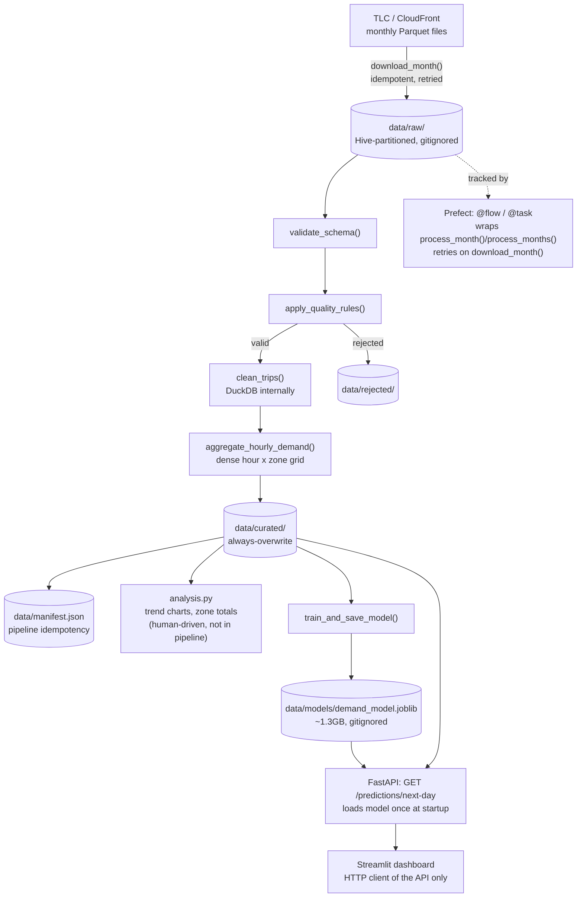

# Architecture

This is a current-state snapshot of the system — what exists today and how the pieces fit
together. For *why* any individual choice was made, see `DECISIONS.md` (a chronological log);
this document only summarizes and links to it, never duplicates its reasoning.

## System diagram

## Data flow, end to end

1. **Ingest** — `download_month(year, month)` fetches one month's raw Parquet file from TLC's
   CloudFront source. Idempotent (skips if the existing file's size matches a live `HEAD`
   check) and atomic (temp-file + rename), with automatic retries (`retries=2`) for transient
   network failures. Stored under `data/raw/year=YYYY/month=MM/` — gitignored; preservation is
   a filesystem guarantee, not a version-control one.
2. **Validate** — `validate_schema()` compares the file's real schema against a recorded
   contract, raising loudly on drift before anything downstream runs.
3. **Quality** — `apply_quality_rules()` splits rows into valid and rejected (quarantine
   pattern, not silent drop/keep); rejected rows are written to `data/rejected/` tagged with
   every rule they failed.
4. **Transform** — `clean_trips()` renames columns to curated naming and derives `pickup_hour`,
   using DuckDB internally for the SQL-shaped work but keeping a strict Polars-in/Polars-out
   boundary.
5. **Aggregate** — `aggregate_hourly_demand()` builds a dense, zero-filled hour × zone grid —
   deliberately not a naive `GROUP BY`, which would silently omit zero-demand combinations.
6. **Curate** — `write_curated()` always overwrites `data/curated/year=YYYY/month=MM/`
   (aggregation is cheap to recompute; downloading is not, hence the different idempotency
   models between raw and curated).
7. **Record** — `record_processed()` writes to `data/manifest.json`, the pipeline-level
   idempotency record sitting on top of each stage's own.

From curated data, two independent downstream paths:

- **Analysis** (`analysis.py`) — human-driven exploration (hourly/day-of-week trend profiles,
  zone comparisons). Never imported by the pipeline; no automated action to take on its output.
- **Prediction** — `train_and_save_model()` trains a `RandomForestRegressor` on all curated
  data and persists `{model, zones, baseline_table, lag_hours}` via `joblib` to
  `data/models/demand_model.joblib`. The **API** (`api.py`) loads that artifact once at
  startup and serves `GET /predictions/next-day` per request without retraining. The
  **dashboard** (`dashboard.py`) is a pure HTTP client of that API — it never imports the
  model directly, avoiding a second load of the 1.3GB artifact in its own process.

## Orchestration

`process_month()`/`process_months()` (`pipeline.py`) compose every ingest-through-curate stage
above into one `@flow`, with each stage itself a `@task` — giving state tracking, timing, and
logging for free on every real run, plus automatic retries on `download_month()` specifically
(the only stage touching something external and unreliable). Scheduling and persistent
monitoring were both investigated and verified working (Lessons 22-23) but are **not deployed**
— they require a standing `prefect server start` process, which contradicts this project's
local-first, no-standing-infrastructure principle. By default, every run uses Prefect's
lightweight ephemeral server, which still persists real execution history to a local SQLite
file (`~/.prefect/prefect.db`) — it just can't *schedule* runs on its own.

## Deployment model

| Component | Runs as |
|---|---|
| Ingestion → curated pipeline (`process_months`) | On-demand, invoked manually (scheduling mechanism proven, not wired into normal operation) |
| Model training (`train_and_save_model`) | On-demand, invoked manually (same — no automated retraining cadence yet) |
| Serving API (`uvicorn ... taxi_pipeline.api:app`) | Long-running process (would be the always-on component in a real deployment) |
| Dashboard (`streamlit run ... dashboard.py`) | Long-running process, depends on the API being reachable |
| Prefect standing server | Bounded demo only (Lessons 22-23) — never run as part of normal operation |

Nothing in this project runs in a container or on any remote infrastructure yet — every
process above runs locally via `uv run`, on a single machine, started and stopped by hand.

## Tech stack and key decisions

| Tool | Role | Decision |
|---|---|---|
| Python 3.12 + `uv` | Reproducible environment | Lesson 1 |
| Polars | Ingestion through curated layer, analysis | Decision #1 |
| DuckDB | SQL-shaped transform/query work | Decision #11 |
| pyarrow | One-off Parquet metadata inspection (diagnostic, not in the pipeline) | Decision #7 |
| scikit-learn (`RandomForestRegressor`) | Demand prediction model | Decisions #24, #26 |
| joblib | Model artifact persistence (free via scikit-learn) | Decision #30 |
| Prefect | `@flow`/`@task` tracking, retries | Decisions #26, #27 |
| FastAPI | Serving API (free via Prefect's own dependency tree) | Decision #30 |
| Streamlit | Dashboard (first non-free dependency since Prefect) | Decision #31 |

## Known limitations

- **Model artifact is ~1.3GB** — unconstrained `RandomForestRegressor` tree growth (Decision
  #30), documented but not fixed; fixing it means re-opening Lesson 18's accuracy trade-offs.
- **No model versioning, validation-before-promotion, or scheduled retraining** — discussed
  conceptually (Lesson 24), not built. The serving API always loads whatever sits at
  `MODEL_PATH`, with no history and no rollback.
- **No containerization** — everything runs locally via `uv`. Planned for a later lesson.
- **No drift monitoring** — nothing currently compares predictions to real outcomes once
  "tomorrow" becomes known data.
